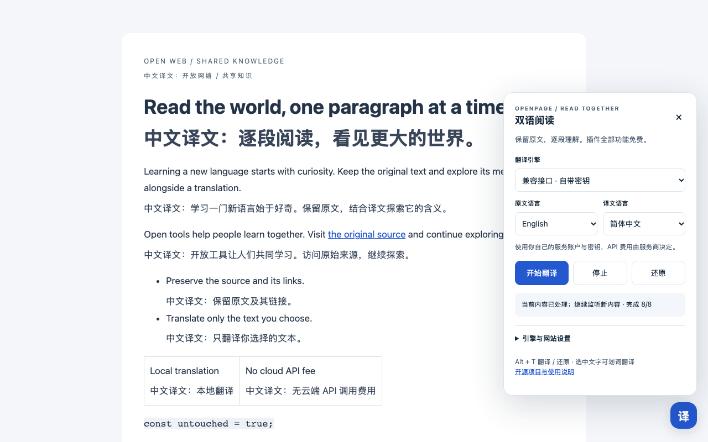

# OpenPage Translate

[简体中文](README.md) · [Installation](docs/install.md) · [Providers](docs/providers.md) · [Privacy](docs/privacy.md) · [Troubleshooting](docs/troubleshooting.md)

A free, open-source Tampermonkey userscript for bilingual web reading. Translations appear below the original paragraphs while existing links and page interactions remain available. It also supports selected-text translation and dynamic content.

The code and interface are independently implemented. This project is not affiliated with Immersive Translate, Youdao, DeepSeek, Tampermonkey, or their providers.



The demonstration uses a public test page and a mock provider with preset translations. It illustrates layout and controls, not the translation quality of a real provider.

## What is free?

**All userscript features are free.** There is no subscription, advertising, project account, or project-operated translation proxy. Provider costs are separate:

| Provider                                    | API cost                            | Requirements                                                                                              |
| ------------------------------------------- | ----------------------------------- | --------------------------------------------------------------------------------------------------------- |
| Browser translation (default, experimental) | No cloud API fees                   | Translator API available in the browser and userscript environment; a language pack may need downloading  |
| Local Ollama                                | No third-party API fees             | Install Ollama, download a local model, and run it on your device                                         |
| Youdao Open Platform                        | Trial credit, then potentially paid | Your application ID and secret; the official pricing page currently states a CNY 50 new-user trial credit |
| DeepSeek / OpenAI-compatible service        | Provider-dependent                  | Your API key, endpoint, and model                                                                         |

Youdao's consumer web/app translation and its official programmatic API are different products. Trial credit is not an unlimited free API. See [Youdao pricing](https://ai.youdao.com/DOCSIRMA/html/trans/price/wbfy/index.html) and [DeepSeek pricing](https://api-docs.deepseek.com/quick_start/pricing/).

Automatic page translation is off by default. If a local provider is unavailable, the userscript asks you to configure one; it **does not silently fall back to a paid provider**. Local hardware, storage, and power remain your responsibility. Ollama cloud models are outside the local, zero-API-fee path.

## Install and translate

1. Install [Tampermonkey](https://www.tampermonkey.net/) in desktop Chrome or Edge, then allow userscripts to run as instructed by the extension.
2. Install the [`v0.1.0` trial userscript](https://github.com/bestows-Z/openpage-translate/releases/download/v0.1.0/openpage-translate.user.js), or find it on the [version page](https://github.com/bestows-Z/openpage-translate/releases/tag/v0.1.0).
3. Open an ordinary webpage and use the bottom-right translation control to choose a provider and target language. The default target is Simplified Chinese.
4. Use the start action or press **Alt + T**. Use the restore action or press Alt + T again to restore the page.
5. If browser translation is unavailable, configure local Ollama or deliberately select a cloud provider using the [provider guide](docs/providers.md).

Set cloud credentials through the **Tampermonkey menu**. The webpage settings panel does not display credentials. The `.meta.js` attachment provides update metadata and is not a standalone installable userscript. Install prerelease updates manually: the `latest` automatic-update channel may be unavailable until the first regular Release is published.

## Features

- Bilingual paragraphs, per-paragraph retry, stop, and restore.
- Select text, use the floating action, and view or copy the translation.
- Dynamic-content scanning, visible-area priority, bounded requests, and an in-memory page cache.
- Automatic or manual source language and configurable target language.
- Per-host automatic-translation and disabled-site rules.
- Browser translation, local Ollama, Youdao, DeepSeek, and a basic OpenAI-compatible adapter.

Automatic language handling depends on the provider and page environment; select a source language when detection is unreliable. The compatible adapter expects Chat Completions with structured JSON output; compatibility is not universal.

## Compatibility and verification

The target environment is desktop **Chrome / Edge with Tampermonkey**. `v0.1.0` is an initial experimental release. Verification passed 87 unit tests and 10 page tests each in Chromium and installed Edge, including one screenshot test per browser. Page tests use mocked GM APIs. Real Tampermonkey installation, local Ollama, and cloud accounts have not completed acceptance testing. See the [verification record](docs/validation.md) for the environment and scope.

Browser translation is enabled only after runtime detection. API exposure, browser version, HTTPS, language packs, site permission policy, and the userscript execution context can affect availability. See the [Chrome documentation](https://developer.chrome.com/docs/ai/translator-api) and [Edge documentation](https://learn.microsoft.com/en-us/microsoft-edge/web-platform/translator-api).

The first release handles ordinary DOM text and skips code, inputs, editable or hidden areas, and `translate="no"` content. PDF layout translation, OCR, subtitles, canvas text, cross-origin iframes, closed shadow roots, browser-internal pages, and extension-store pages are outside the current scope. Virtual lists and unusual layouts may need specific adaptations.

## Privacy

Translation runs when you trigger it or enable an automatic rule for a site. The browser provider handles text locally; Ollama receives text at your configured local service; a cloud provider receives the selected page text. Choose a provider suitable for the contents of the page.

Credentials stay in Tampermonkey storage and are not written to the website's `localStorage`, public page DOM, source code, or URLs. GM storage is not a hardware credential vault. The project has no telemetry or translation proxy and does not upload its cache. See the [privacy guide](docs/privacy.md) for network permissions and custom endpoint authorization.

## Development

Use Node.js **24.13.0 or later** and the pnpm version declared in `package.json`.

```sh
pnpm install --frozen-lockfile
pnpm check
pnpm exec playwright install chromium
pnpm test:e2e
pnpm check:publish
pnpm build
```

With desktop Edge installed, `TEST_EDGE=1 pnpm test:e2e` also runs the mocked page integration tests in Edge. These still use mocked GM APIs.

The build produces `dist/openpage-translate.user.js` and `dist/openpage-translate.meta.js`. Generated files are not tracked on `main`; installable artifacts are distributed as Release attachments.

Source lives in `src/`, tests in `tests/`, build checks in `scripts/`, public guides and optional workflow templates in `docs/`, and issue templates in `.github/`.

## Contributing and licensing

The repository has **one branch: `main`**. Versions use tags and Releases. This version uses local checks and manual releases; optional CI and tag release templates live in `docs/github-actions/`. See the [release guide](docs/releasing.md) to enable them. There are no feature, release, or `gh-pages` branches in this repository.

Use [Issues](https://github.com/bestows-Z/openpage-translate/issues), external forks, or patches. Read [CONTRIBUTING](CONTRIBUTING.md), the [Code of Conduct](CODE_OF_CONDUCT.md), and the [security policy](SECURITY.md). Do not publish credentials or personal information in an issue.

See [CHANGELOG](CHANGELOG.md) for changes. Project code is licensed under [MIT](LICENSE); third-party services, dependencies, and models retain their own licenses as explained in [THIRD_PARTY_NOTICES](THIRD_PARTY_NOTICES.md).
